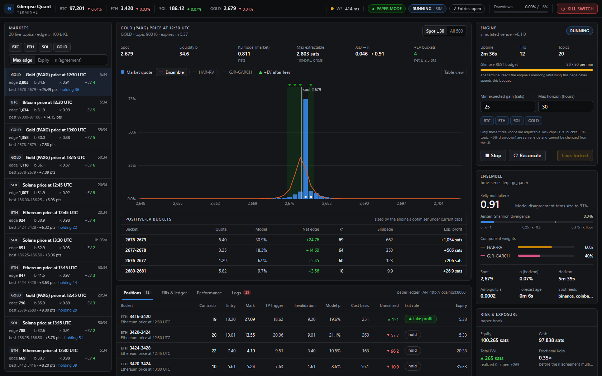
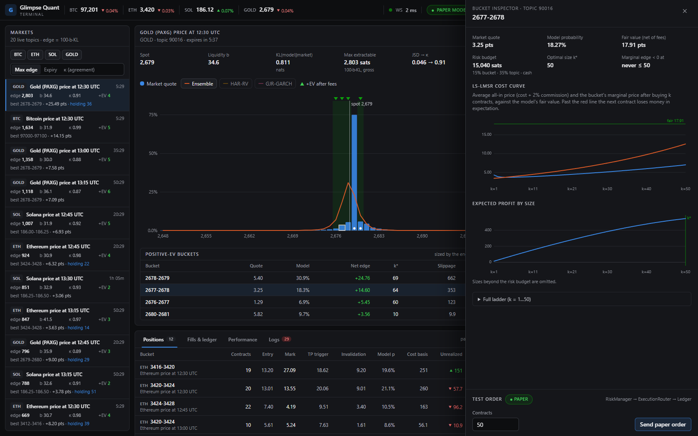
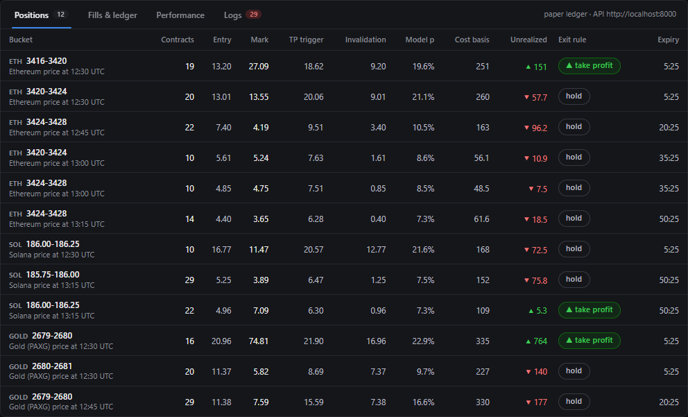
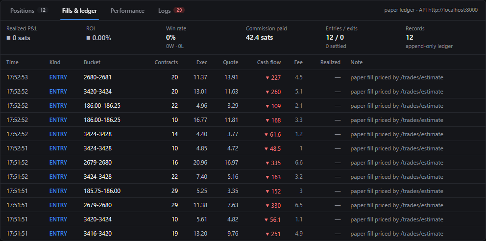
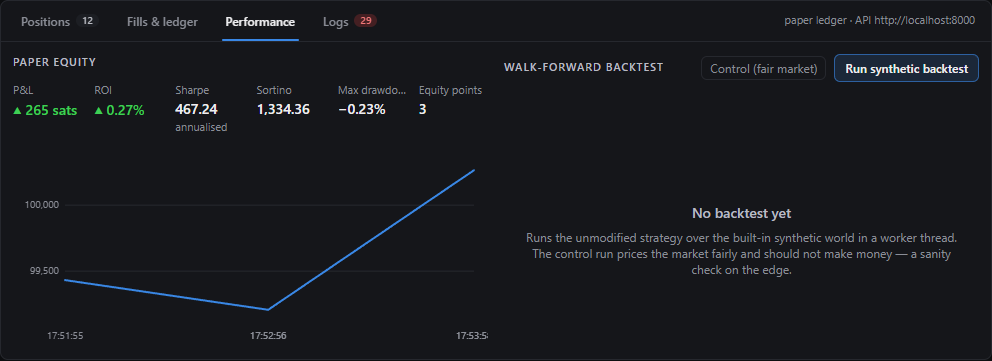
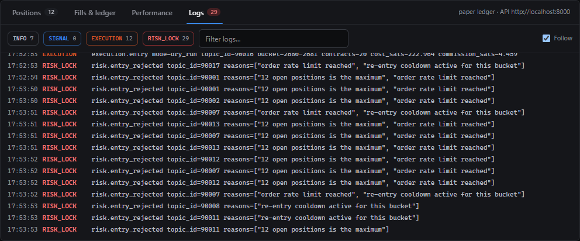

# glimpse-quant-bot

A probability-calibration and LS-LMSR execution engine for [Glimpse](https://www.glimpse.markets) — the Bitcoin-settled forecasting market whose contracts pay ₿100 if an asset closes inside a price bucket. The bot forecasts the full closing-price distribution of **BTC, ETH, SOL and Gold**, compares it bucket by bucket with the market maker's quotes, and trades only where the gap survives slippage and fees.

It is built on the official SDK (`glimpse-markets >= 0.2.0`), is MIT-licensed, and **paper-trades by default**: Glimpse has no sandbox, so real orders need two separate opt-ins.



<sub>The [Quant Terminal](#quant-terminal) running `glimpse-quant-bot serve --demo` (simulated venue, paper only). More screenshots [below](#screenshots).</sub>

```text
MarketDataHub ──▶ EnsembleForecaster ──▶ SlippageOptimizer ──▶ RiskManager ──▶ ExecutionRouter
 Deribit options     options RND             local LS-LMSR         caps, breaker,    SDK calls,
 Binance/Coinbase/   HAR + microstructure    replica + server      trading lock,     dry_run default,
 Kraken spot, perps  GJR-GARCH / TimesFM     estimate ladder       reconciler        no blind retries
                                                    │
                                              Ledger (append-only SQLite + NDJSON)
```

## Status

| Check | Result |
|---|---|
| `pytest` | 134 passed (incl. 33 terminal-server safety tests) |
| `ruff check .` | clean |
| `mypy --strict` on `src` and `tests` | clean |
| Local LS-LMSR pricer vs live `/trades/estimate` | identical to the millisat (buy, sell, multi-leg, fractional) |
| Local LS-LMSR pricer vs the Glimpse whitepaper | reproduces every published figure |
| Live forecast, all four assets | bucket probabilities sum to 1.0 |
| Dry-run example trades on live markets | [`examples/sample_trades.md`](examples/sample_trades.md) |
| Live (real-money) order path | **not exercised** — no API key was used in development |

## Quantitative thesis

A Glimpse topic is a 500-bucket partition of the price axis run by a single automated market maker. Its quotes are whatever the last few traders left behind, and depth is thin: the liquidity parameter `b` of live topics is **13–40 contracts**. Three things follow.

1. **The market quotes a full distribution, so a better distribution is an edge in every bucket at once.** The bot builds one from three independent views and pools them:

   | Component | Weight (BTC, ETH) | Weight (SOL, Gold) | What it contributes |
   |---|---:|---:|---|
   | **Options risk-neutral density** — Breeden-Litzenberger on a smoothed Deribit smile | 50% | – | The options market's own forward-looking distribution, including skew and fat wings |
   | **HAR-RV + microstructure** — log-HAR realised variance, skewed Student-t shaped by funding and order-book imbalance | 30% | 60% | Horizon-matched volatility and short-term directional lean |
   | **GJR-GARCH(1,1)** with filtered historical simulation, or TimesFM 2.5 if installed | 20% | 40% | An empirical, leverage-aware return distribution |

   Weights re-normalise when a component is unavailable (Deribit lists no SOL or gold options), so probabilities always sum to one. Cross-model Jensen-Shannon divergence scales the Kelly fraction down when the models disagree.

2. **Quoted edge is not tradeable edge.** LS-LMSR prices are convex in size. On a topic with `b = 37`, buying 20 contracts of an 18-point bucket costs an average of 22.2 points. The bot therefore prices a ladder of sizes and maximises expected profit *in millisats* after the 2% commission and the 2% settlement fee.

3. **The cost function is public, so pricing can be local.** `lmsr.py` re-implements Glimpse's cost function exactly. Screening candidate sizes costs zero API requests; the rate limit is spent only on confirming the size the bot intends to trade.

**Capacity, stated plainly.** The most a trader can extract from a mispriced bucket is about `100 · b · KL(p_model ‖ p_market)` sats — typically 10–150 sats per trade at today's depth. A 0.001 BTC bankroll is never the binding constraint; market depth is. The Kelly fraction and the 15% / 35% caps exist to prevent ruin, not because they usually bind.

## The mathematics

**LS-LMSR** (Glimpse whitepaper eq. 1–2; Othman, Sandholm, Pennock and Reeves, 2010)

```text
C(q) = 100 · b(q) · ln Σⱼ exp(qⱼ / b(q))        b(q) = α Σⱼ qⱼ        α = v / (n ln n)
pᵢ   = ∂C/∂qᵢ = 100 · [ wᵢ + α H(w) ]           w = softmax(q / b)    H = Shannon entropy
cost of a trade = C(q′) − C(q)    (+2% commission, 1 sat minimum on buys)
```

**Breeden-Litzenberger** (1978)

```text
f(K) = e^{rT} ∂²C/∂K²          P(a < S_T ≤ b) = ∫ₐᵇ f(K) dK
```

The smile is a weighted quadratic in standardised log-moneyness, continued in the wings as *linear total variance in log-moneyness* with the slope capped inside Roger Lee's bound `|dw/dk| < 2`. The density is floored at zero and renormalised with `np.trapezoid`, so the CDF is non-decreasing on `[0, 1]` by construction.

**HAR realised variance** (Corsi, 2009), on Garman-Klass hourly bar variances, iterated forward to the market's expiry

```text
xₜ = ln RVₜ        xₜ₊₁ = c + β₁ xₜ + β₂ mean₂₄ₕ(x) + β₃ mean₁₆₈ₕ(x) + ε
```

**Sizing** — a contract bought at all-in price `c` pays `π = 100·(1 − fee)` with probability `p`:

```text
maximise over k:   k · p · π  −  [ C(q + k·eᵢ) − C(q) + commission(k) ]
subject to:        net edge per contract ≥ 2.5 points,   expected gain ≥ 25 sats,
                   cost ≤ 0.35 · κ · f* · bankroll,       f* = (p·π − c) / (π − c)
                   cost ≤ 15% of equity per bucket,  35% per topic
```

`κ ∈ [0.25, 1]` is the model-disagreement multiplier.

**Exits.** Positions are not held blindly to a binary settlement. Each tick: *take profit* when `P_market ≥ P_model − 1.0` and selling nets more than was paid; *invalidate* when `P_model` falls more than 4.0 points below the entry price.

## Quickstart

```bash
git clone <this-repo> && cd glimpse-quant-bot
python -m venv .venv && source .venv/bin/activate      # Windows: .venv\Scripts\activate
pip install -e ".[dev]"
cp .env.example .env                                   # optional: defaults are safe
```

```bash
glimpse-quant-bot demo-trades
```

That scans the live markets, prices the best mispricings on Glimpse's own estimate endpoint, paper-executes the survivors and writes `examples/sample_trades.md`. It needs no API key.

```bash
glimpse-quant-bot run --duration 3600
```

Runs the full stream-driven loop in paper mode for an hour, then prints the ledger.

```bash
glimpse-quant-bot backtest --synthetic
```

Optional TimesFM 2.5 (Apache-2.0, pulls in PyTorch): `pip install -e ".[timesfm]"`. Without it the time-series slot uses the NumPy GJR-GARCH model.

### Docker

```bash
docker compose up --build
```

That starts the terminal API (`api`, on `127.0.0.1:8000`, paper mode) and the UI (`frontend`, on `127.0.0.1:3000`). The ledger and recordings live on named volumes (`ledger`, `recordings`). `docker compose run --rm --service-ports api serve --host 0.0.0.0 --demo` runs the API against the simulated venue instead; `docker compose run --rm bot demo-trades` runs any other command; `docker compose --profile record up recorder` records the feed for a day. The headless `bot` service sits in the `headless` profile so it never shares the ledger with `api`.

## Quant Terminal

A local web terminal over the running engine: a FastAPI + WebSocket server (`glimpse-quant-bot serve`) in the same event loop as the trading loop, and a Next.js UI in [`frontend/`](frontend/). It adds no pricing, sizing or risk logic of its own; [`docs/TERMINAL.md`](docs/TERMINAL.md) maps every panel to the engine object behind it.

```bash
pip install -e ".[server]"
glimpse-quant-bot serve --demo        # simulated venue, no network, no key, paper only
# or: glimpse-quant-bot serve         # live Glimpse feed, paper trading
```

```bash
cd frontend
npm install
npm run dev                           # http://localhost:3000
```

What it shows:

- **Top ribbon:** BTC/ETH/SOL/GOLD spot, WebSocket latency, `PAPER MODE` / `LIVE ARMED`, the intraday drawdown against the −6% breaker, lock state and the kill switch.
- **Distribution chart:** all 500 buckets of the focused market (zoom from spot ±30 buckets to the full range), market quotes as bars, the ensemble as a line, toggles for the options RND, HAR-RV and GJR-GARCH components, and +EV buckets after fees highlighted.
- **Bucket inspector:** click a bar to see the LS-LMSR cost of buying k = 1…50 contracts, where the marginal edge turns negative, and a test-order ticket that goes through `RiskManager` → `ExecutionRouter` → `Ledger`.
- **Side panels:** run parameters and start/stop/reconcile, ensemble agreement (JSD gauge, κ ∈ [0.25, 1]), and exposure against the 15% bucket and 35% topic caps.
- **Tabs:** open positions (entry, mark, take-profit, invalidation, unrealised P&L in sats), fills and ledger, performance, and logs filterable by `INFO` / `SIGNAL` / `EXECUTION` / `RISK_LOCK`.

### Screenshots

Captured from `glimpse-quant-bot serve --demo`: the simulated venue, so spot prices and fills are synthetic and every order is a paper fill. Paper trades against live Glimpse markets are in [`examples/sample_trades.md`](examples/sample_trades.md).

**Bucket inspector.** Clicking a bar prices k = 1…50 contracts on the local LS-LMSR replica. The cost curve crosses the model's fair value where the marginal contract stops paying, and expected profit peaks at the optimiser's k\*.



**Open positions.** Entry, mark, take-profit trigger and invalidation level for each paper position. The exit rule flips to *take profit* when the market converges to the model, and the next mark tick sells it.



**Fills and ledger.** Every paper fill from the append-only ledger, with executed price against quote (the slippage), cash flow and commission.



**Performance and logs.** The paper equity curve, plus the structured event stream: `EXECUTION` rows for fills, `RISK_LOCK` rows for every entry the risk manager refused, and why.





Safety, enforced by the server rather than the UI (each rule has a test in `tests/test_server.py`):

- Paper is the default of every request and of the engine. Going live needs `GLIMPSE_LIVE_TRADING=true`, `GLIMPSE_API_KEY`, `serve --allow-live`, the real venue, and a typed arming phrase that yields a single-use token valid for 60 s. The simulator can never go live.
- Risk caps, the drawdown limit and the Kelly fraction cannot be changed over HTTP; request models reject unknown fields.
- Page loads and the WebSocket read in-memory state only, so refreshing the UI makes no Glimpse REST calls.
- The server binds to `127.0.0.1`. Mutating requests need an allowed `Origin` and the `X-GQB-Intent: operator` header, and the WebSocket checks `Origin`.

The TypeScript API types in `frontend/src/lib/contract.ts` are generated from the Pydantic models (`python -m glimpse_quant_bot.server.typescript > frontend/src/lib/contract.ts`); a test fails if they drift.

## CLI reference

| Command | What it does | Places orders? |
|---|---|---|
| `run [--live] [--duration S]` | Stream-driven trading loop with reconnect | Only with `--live` **and** `GLIMPSE_LIVE_TRADING=true` |
| `serve [--demo] [--allow-live] [--port N]` | Quant Terminal API + WebSocket around the same engine | Paper by default; live needs `--allow-live`, `GLIMPSE_LIVE_TRADING=true`, an API key and typed arming in the UI |
| `demo-trades [--max-trades N] [--out FILE]` | One-shot scan, server-priced ladders, paper fills, Markdown report | Never |
| `record [--duration S] [--out DIR]` | Records the WebSocket feed (`MarketRecorder` NDJSON), spot, candles, metadata | Never |
| `backtest --synthetic \| --data-dir DIR` | Walk-forward replay: Sharpe, Sortino, max drawdown, win rate, ROI | Never |
| `report [--live] [--ledger FILE]` | Ledger summary and recent fills | Never |
| `reconcile` | Aligns the live ledger with `portfolio_active()` (needs an API key) | Never |

Every command accepts `--min-expected-gain-sats`, `--max-horizon-hours` and `--data-dir`. All settings are listed in [`.env.example`](.env.example).

## Safety design

- **Dry run is the default everywhere.** The client is built with `AsyncClient.from_env(dry_run=True)`, and the execution router additionally passes `dry_run` on every call, so a mis-constructed client still cannot trade.
- **Two opt-ins for real money.** `--live` on the command line *and* `GLIMPSE_LIVE_TRADING=true` in the environment *and* an API key. `--live` without the others is an error, not a silent fallback.
- **Zero blind retries.** Glimpse has no idempotency key. On `GlimpseAmbiguousTradeStateError` the bot locks trading, fetches `portfolio_active()`, diffs it against the append-only ledger, writes one adjustment row per difference, and only then unlocks. If the portfolio cannot be fetched it stays locked. The order is never resubmitted. `tests/test_risk_reconciler.py` proves the single-submission property with a counting fake exchange.
- **Millisats and price points never mix.** Money is `Millisats`, quotes are `PriceUnits`, in separate fields and separate ledger columns; two named helpers are the only crossings.
- **Hard guardrails.** 15% of equity per bucket, 35% per topic, a −6% intraday drawdown kill-switch (resets at 00:00 UTC), order-rate and re-entry limits, a time-to-expiry window. Exits are never blocked by the caps.
- **Rate-limit discipline.** Decisions are driven by the WebSocket feed; one REST page per batch every 45 s refreshes 24 complete books; the client is throttled to 50 requests per minute against Glimpse's limit of 60.
- **Commercially clean data.** Deribit, Binance, Coinbase and Kraken public endpoints only. No `yfinance`.
- **Unit guard.** Ratio-quoted batches (gold in sats per ounce, WTI/BTC) are excluded: the models forecast USD prices.

## Backtest

`backtest --synthetic` builds a world with a known data-generating process: a driftless GBM underlying and twelve 3-hour topics whose market-maker quotes are *stale* (centred on the spot 45 minutes ago) and *too wide* (volatility ×1.5), converging to the truth by expiry. Fills are priced on the local LS-LMSR replica with all fees; the bot's own fills move the book.

| Run | Net P&L | ROI | Entries / exits / settlements | Win rate | Max drawdown |
|---|---:|---:|---:|---:|---:|
| Mispriced, default 25-sat floor (seed 11) | +4,872 sats | +4.87% | 291 / 243 / 6 | 71.9% | 1.54% |
| Mispriced, `--min-expected-gain-sats 20` (seed 11) | +5,001 sats | +5.00% | 296 / 244 / 6 | 70.4% | 1.58% |
| Mispriced, seed 3 | +8,154 sats | +8.15% | 298 / 257 / 6 | 77.6% | 1.12% |
| Mispriced, seed 29 | +8,028 sats | +8.03% | 309 / 255 / 9 | 76.1% | 1.69% |
| **Control** — correctly priced market | 0 sats | 0.00% | 0 / 0 / 0 | – | 0.00% |

Read this for what it is. The mispricing is put there by construction, so the table shows that the pipeline *harvests* an edge when one exists and *stands aside* when none does — not that live markets offer this edge. Annualised Sharpe figures from a 15-hour synthetic window (50–90) are printed by the tool but are not meaningful performance claims. A real answer needs `record` data over weeks.

## Limitations

- **The live order path is untested.** Everything up to the SDK call is covered by tests against a fake exchange, but no real order has been placed. `wallet_balance()` and the live exit response have no published schema and are parsed defensively.
- **Settlement source.** The bot uses the median of Binance, Coinbase and Kraken as spot. Which venue Glimpse settles on is not documented; a few dollars of basis matters for $200 buckets near expiry.
- **Risk-neutral is not physical.** The options density includes risk premia. It is one of three inputs for that reason.
- **Recorded prices are rounded.** `MarketRecorder` stores 0–100 quotes, not share vectors, so replaying a recording reconstructs the book under an assumed depth (`GQB_BACKTEST_LIQUIDITY_B`).
- **TimesFM path not exercised here** (PyTorch was not installed in development). The GJR-GARCH fallback is what was tested.
- **Not low-latency in the HFT sense.** This is an asyncio Python process with millisecond-scale reaction times. Glimpse's market maker has no queue to race for, so that is the right tool; see ARCHITECTURE.md §9.
- **SDK pagination.** The server ignores `page` / `page_size`, so `batch_active_markets_page` returns the 24 nearest-expiry markets per batch. The default 30-hour horizon fits inside that.

## Design lineage

Patterns were taken from open-source quant stacks on three continents; [`ARCHITECTURE.md`](ARCHITECTURE.md) documents each one and what was deliberately left out.

| Ecosystem | Projects studied | What this bot adopted |
|---|---|---|
| United States | NautilusTrader, Hummingbot, LMSR market makers (Hanson; Othman et al.) | Backtest/live parity through shared components and an injected clock; inventory-aware budgets; an exact cost-function replica |
| Europe | Deribit volatility-surface tooling, ccxt, vectorbt | Breeden-Litzenberger density from a smoothed smile; a uniform venue interface with failover; vectorised NumPy models |
| China | vn.py (VeighNa), Microsoft Qlib | Strict one-way module pipeline; a pre-trade risk gatekeeper with flow control; a small factor layer feeding the model |

## Repository layout

```text
src/glimpse_quant_bot/
  config.py            validated settings, dry-run defaults, live-arming rule
  types.py             Millisats/PriceUnits domain models, asset classifier
  external_feeds.py    Deribit, Binance, Coinbase, Kraken with TTL cache and failover
  options_density.py   smile fit, Lee-bounded wings, Breeden-Litzenberger density
  forecaster.py        HAR-RV, GJR-GARCH, skewed-t, ensemble pooling
  lmsr.py              exact local LS-LMSR cost function
  lmsr_optimizer.py    slippage ladder, expected-profit maximiser, Kelly sizing, exit rules
  risk_manager.py      caps, drawdown breaker, trading lock, reconciler
  execution.py         the only module that calls trade-mutating SDK methods
  ledger.py            append-only SQLite + NDJSON audit log
  strategy.py          glimpse_markets.Strategy subclass for StrategyRunner
  backtester.py        walk-forward replay and synthetic world
  demo.py, cli.py      example-trades generator and command line
  server/              Quant Terminal: controller, FastAPI app, telemetry hub,
                       Pydantic contract, TypeScript generator, simulated venue
frontend/              Next.js Quant Terminal UI (TypeScript strict, Tailwind)
docs/TERMINAL.md       how the terminal maps onto the engine and keeps its safety rules
tests/                 density, pricer, optimiser, reconciler, replay, terminal server
examples/sample_trades.md
```

## Disclaimer

This is research software. Event contracts on Glimpse are digital-asset derivatives; you can lose everything you put in, and they are not available in every jurisdiction. Nothing here is investment advice. Run it in paper mode until you have your own evidence.

## License

MIT — see [LICENSE](LICENSE).
